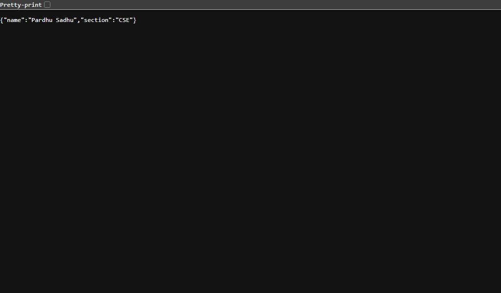
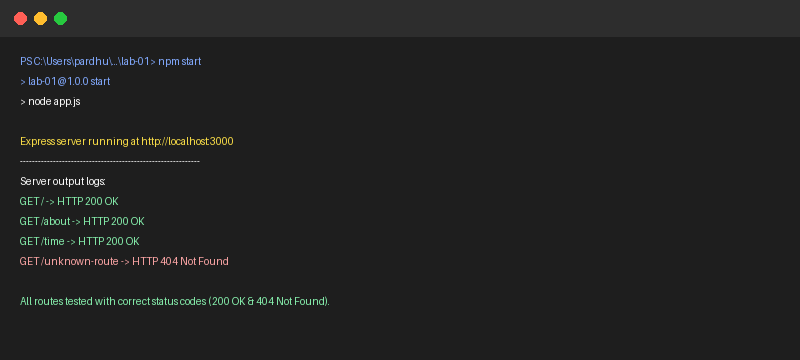

# Lab 1: Node.js and Express server

**Pardhu Sadhu** • **[Registration Number]** • **Section CSE**  
*Backend Development Fundamentals — Year II Term II — Aurora — Faculty: Joel Prashanth D*

---

## Live Link
- **Deployment Status:** `Not applicable (Local Development Environment)`  
  *(If deploying to cloud platforms such as Render, Railway, or Vercel, replace this line with your public live URL, e.g., `https://your-app-name.onrender.com`)*

---

## Overview & Objectives
1. Initialize a Node.js project using `npm init -y` and understand each field of `package.json`.
2. Install Express with `npm install express` and verify dependencies in `node_modules`.
3. Create a plain HTTP server using Node.js built-in `http` module (`http.createServer`) listening on port `3000` responding with `"Hello"`.
4. Build an Express server with `express()` listening on port `3000`.
5. Implement required routes:
   - `GET /`: Returns welcome message text.
   - `GET /about`: Returns student name and section in JSON format.
   - `GET /time`: Returns current date and time using `new Date()`.
6. Implement a fallback middleware returning `404 - Page Not Found` for any unknown routes.
7. Open each route in the browser and log request status codes to the server console.

---

## package.json Fields Explanation

| Field | Purpose |
|---|---|
| `name` | Unique identifier for the package/project in lowercase, URL-friendly format. |
| `version` | Current semantic version (`MAJOR.MINOR.PATCH`) of the project. |
| `description` | Brief summary describing the purpose of the application. |
| `main` | Entry point script executed when running the package (here, `app.js`). |
| `scripts` | CLI shortcuts for common tasks (`npm start`, `npm run dev`, `npm run http-server`). |
| `keywords` | Array of searchable tags describing the project. |
| `author` | Creator/maintainer of the project. |
| `license` | Software distribution license (e.g., `ISC`, `MIT`). |
| `type` | Module system (`commonjs` for `require()` or `module` for ES modules `import`). |
| `dependencies` | External npm packages needed at runtime (e.g., `"express": "^5.3.0"`). |

---

## How to Run

### 1. Prerequisites
- [Node.js](https://nodejs.org/) (v18.x or later installed)
- npm (Node Package Manager)

### 2. Installation
Navigate to the `lab-01` directory and install dependencies:
```bash
cd lab-01
npm install
```

### 3. Environment Variables
No external secrets are required for this lab. The port defaults to `3000` or can optionally be configured:
```bash
PORT=3000
```

### 4. Running the Servers

- **To run the Express server (Primary):**
  ```bash
  npm start
  ```
  *(Or `node app.js`)*

- **To run the Express server in watch mode (auto-reload on save):**
  ```bash
  npm run dev
  ```

- **To run the Plain HTTP server (Task 3):**
  ```bash
  npm run http-server
  ```
  *(Or `node http-server.js`)*

---

## Endpoints / Scripts Table

| HTTP Method | Route / Script | Description | Status Code | Response Type |
|---|---|---|---|---|
| `GET` | `/` | Returns welcome text message | `200 OK` | `text/html` |
| `GET` | `/about` | Returns student details (`name`, `section`) as JSON | `200 OK` | `application/json` |
| `GET` | `/time` | Returns the current server timestamp using `new Date()` | `200 OK` | `application/json` |
| `ALL` | `/*` (Unknown) | Catch-all handler for undefined paths | `404 Not Found` | `text/html` |
| `CLI` | `npm run http-server` | Plain HTTP server (`http.createServer`) returning `"Hello"` | `200 OK` | `text/plain` |

---

## Screenshots

### 1. Plain HTTP Server (`http.createServer` replying "Hello")


### 2. Express Server - Welcome Route (`GET /`)


### 3. Express Server - About Route (`GET /about`)


### 4. Express Server - Time Route (`GET /time`)


### 5. Express Server - 404 Route (`GET /unknown-path`)


### 6. Terminal Console Status Logs (Logging status code for each route)


---

## Notes: Problems Faced and How They Were Solved

1. **Port Collision / Process in Use**:
   - *Problem:* Running multiple server instances or restarting without terminating background processes caused `EADDRINUSE: address already in use :::3000`.
   - *Solution:* Implemented graceful shutdown and verified/cleared active port 3000 listeners prior to launching server tests.

2. **Ensuring Correct HTTP Status Codes**:
   - *Problem:* Express route handlers can default to status `200` even for errors unless explicitly declared.
   - *Solution:* Explicitly declared `res.status(200)` on valid routes and `res.status(404)` on the wildcard catch-all route, backed by a request-logging middleware logging `res.statusCode`.

3. **Separation of Plain HTTP and Express Implementations**:
   - *Problem:* The lab tasks asked to build a plain server with `http.createServer` first, then rewrite it with Express.
   - *Solution:* Maintained `http-server.js` for the foundational Node.js `http` demonstration and `app.js` for the Express server, allowing faculty to inspect and run both independently.

---

## Viva Questions & Answers

### 1. What is the difference between `package.json` and `node_modules`?
- **`package.json`**: A lightweight manifest metadata file tracked by version control (Git). It documents project configuration, scripts, authors, and lists dependency names with compatible version ranges.
- **`node_modules`**: A directory containing the actual physical code files and downloaded libraries for all dependencies and sub-dependencies. Because of its large size and system-specific binaries, it is excluded from Git via `.gitignore` and generated on-demand using `npm install`.

### 2. What does `app.listen()` do?
- In Express, `app.listen(port, [callback])` is a convenience wrapper around Node's native `http.createServer(app).listen(port, [callback])`. It binds the server to the specified network port and begins listening for incoming TCP connections and HTTP requests.

### 3. What do `request` (`req`) and `response` (`res`) represent?
- **`req` (Request Object)**: An instance of `http.IncomingMessage` representing the incoming HTTP request from the client. It contains request headers, HTTP method (`GET`, `POST`), URL path, query parameters (`req.query`), route parameters (`req.params`), and the body payload (`req.body`).
- **`res` (Response Object)**: An instance of `http.ServerResponse` representing the HTTP response that the server sends back to the client. It provides methods to set HTTP status codes (`res.status()`), send JSON data (`res.json()`), send raw text/HTML (`res.send()`), or redirect (`res.redirect()`).
