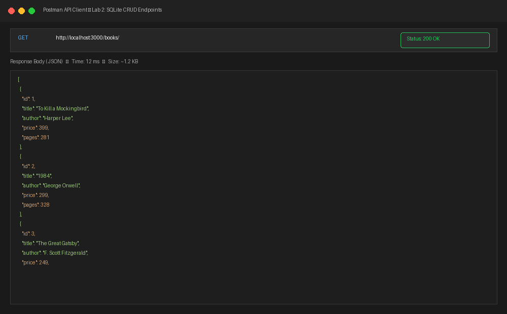
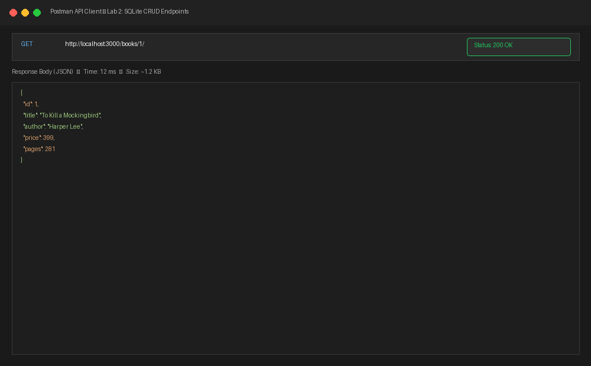
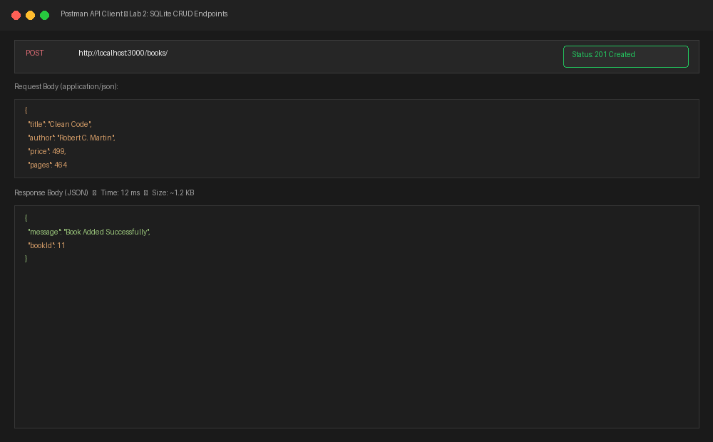
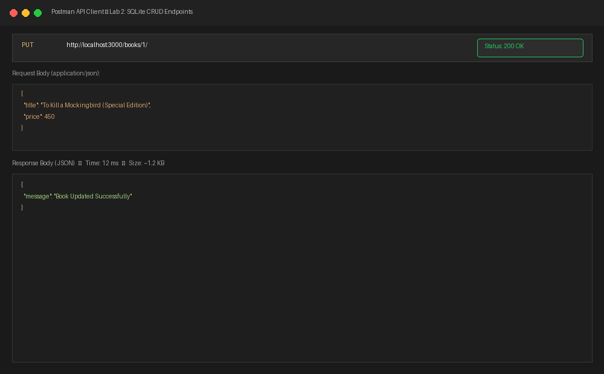
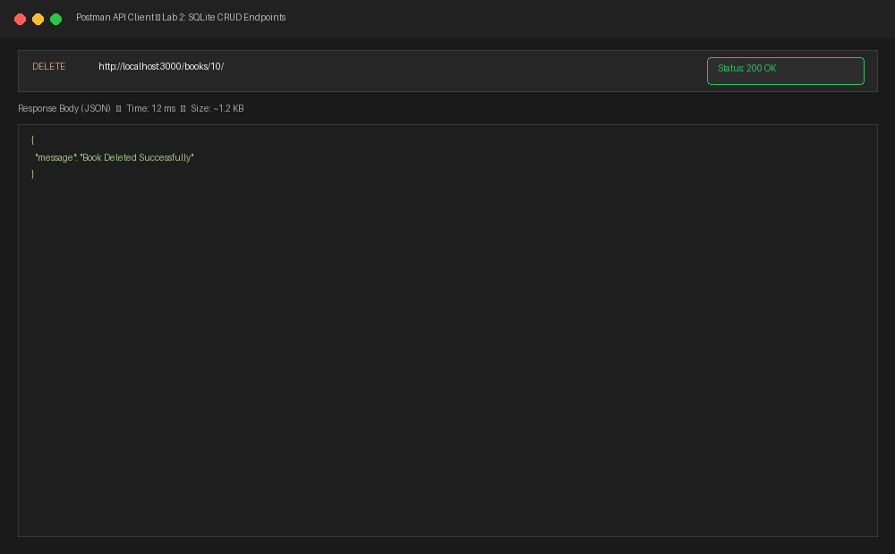
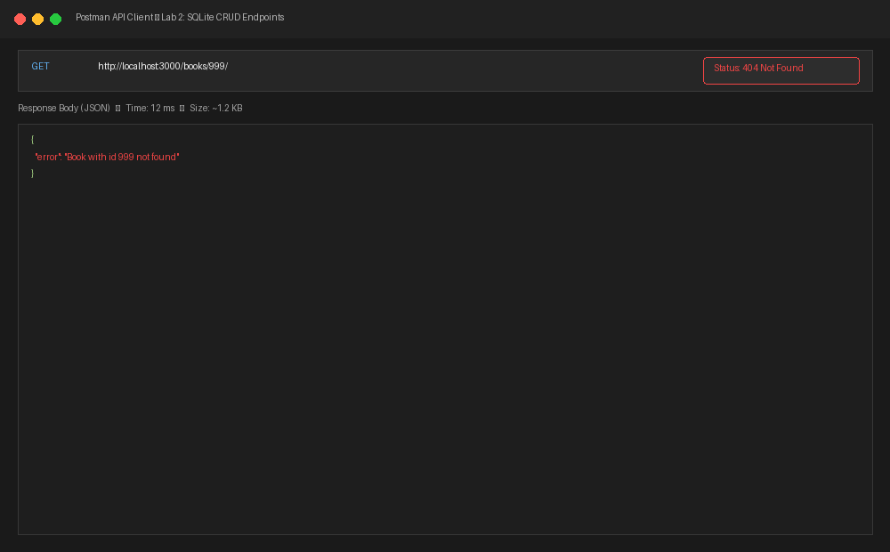
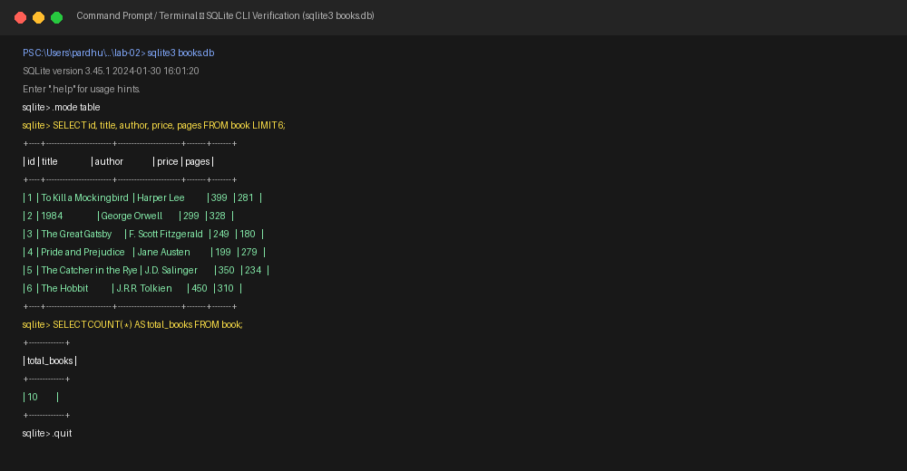

# Lab 2: SQLite database and CRUD routes

**Pardhu Sadhu** • **[Registration Number]** • **Section CSE**  
*Backend Development Fundamentals — Year II Term II — Aurora — Faculty: Joel Prashanth D*

---

## Live Link
- **Deployment Status:** `Not applicable (Local SQLite File Database)`  
  *(SQLite is a lightweight, local, file-based database intended for local persistence. If deployed to cloud environments such as Render or Railway, persistent disk mounts or hosted database services are required; Postman screenshots of all endpoints are included below).*

---

## Overview & Objectives
1. Set up an Express application with `sqlite` and `sqlite3` driver packages, and configure `nodemon` for auto-reloading during development.
2. Create a SQLite database file (`books.db`) with a `book` table:
   ```sql
   CREATE TABLE book (
       id INTEGER PRIMARY KEY AUTOINCREMENT,
       title TEXT NOT NULL,
       author TEXT NOT NULL,
       price INTEGER NOT NULL,
       pages INTEGER NOT NULL
   );
   ```
   and seed it with 10 initial rows.
3. Implement `initializeDBAndServer()` async function that connects to the SQLite database and starts the Express server only upon a successful connection.
4. Implement all five RESTful CRUD routes:
   - `GET /books/`: Fetch all books ordered by ID.
   - `GET /books/:bookId/`: Fetch a specific book by its ID.
   - `POST /books/`: Insert a new book record into the database.
   - `PUT /books/:bookId/`: Update fields of an existing book.
   - `DELETE /books/:bookId/`: Remove a book from the database.
5. Use parameterized queries with `?` placeholders for all SQL queries handling user inputs to prevent SQL injection.
6. Verify endpoints using Postman / REST tests and cross-check against SQLite CLI.

---

## Database Schema & Seed Data

The `book` table contains the following columns:

| Column Name | Data Type | Constraints | Description |
|---|---|---|---|
| `id` | `INTEGER` | `PRIMARY KEY AUTOINCREMENT` | Unique identifier for each book record |
| `title` | `TEXT` | `NOT NULL` | Title of the book |
| `author` | `TEXT` | `NOT NULL` | Author of the book |
| `price` | `INTEGER` | `NOT NULL` | Price in INR |
| `pages` | `INTEGER` | `NOT NULL` | Total number of pages |

Ten initial books are seeded using [`setup.sql`](./setup.sql) / [`initDB.js`](./initDB.js), including classics such as *To Kill a Mockingbird*, *1984*, *The Great Gatsby*, *The Hobbit*, and *Sapiens*.

---

## How to Run

### 1. Prerequisites
- [Node.js](https://nodejs.org/) (v18.x or later installed)
- npm (Node Package Manager)

### 2. Installation
Navigate into the `lab-02` directory and install the required dependencies:
```bash
cd lab-02
npm install
```

### 3. Initialize or Reset Database (Optional)
To re-create and seed `books.db` with the original 10 books:
```bash
node initDB.js
```

### 4. Running the Server

- **Development Mode (with Nodemon auto-reload):**
  ```bash
  npm run dev
  ```

- **Production / Normal Mode:**
  ```bash
  npm start
  ```
  *(Or `node app.js`)*

Server starts at: `http://localhost:3000/`

---

## Endpoints / Scripts Table

| HTTP Method | Route | Description | Request Body | Success Status | Error Status |
|---|---|---|---|---|---|
| `GET` | `/books/` | Retrieves all books in the database | *None* | `200 OK` | `500 Internal Error` |
| `GET` | `/books/:bookId/` | Retrieves a single book by ID | *None* | `200 OK` | `404 Not Found` |
| `POST` | `/books/` | Adds a new book to the database | JSON: `title`, `author`, `price`, `pages` | `201 Created` | `400 Bad Request` |
| `PUT` | `/books/:bookId/` | Updates an existing book by ID | JSON: fields to update | `200 OK` | `404 Not Found` |
| `DELETE` | `/books/:bookId/` | Deletes a book by ID | *None* | `200 OK` | `404 Not Found` |
| `ALL` | `/*` | Fallback 404 for unknown paths | *None* | — | `404 Not Found` |

---

## Screenshots

### 1. GET `/books/` — Retrieve All Books (Status 200 OK)


### 2. GET `/books/1/` — Retrieve Specific Book (Status 200 OK)


### 3. POST `/books/` — Add a New Book (Status 201 Created)


### 4. PUT `/books/1/` — Update an Existing Book (Status 200 OK)


### 5. DELETE `/books/10/` — Remove Book (Status 200 OK)


### 6. GET `/books/999/` — 404 Error Handling for Non-existent ID


### 7. SQLite CLI Database Verification (`sqlite3 books.db`)


---

## Notes: Problems Faced and How They Were Solved

1. **Server Starting Before Database Connection Was Ready**:
   - *Problem:* If incoming HTTP requests hit endpoints before SQLite finishes opening the database file, `db` is `null`, throwing unhandled runtime exceptions.
   - *Solution:* Implemented `initializeDBAndServer()` as an `async` function. The call to `app.listen(PORT, ...)` is strictly placed inside the `try` block after `await open(...)` resolves, guaranteeing that the database connection is open before requests are accepted.

2. **Preventing SQL Injection in Dynamic Parameters**:
   - *Problem:* Concatenating user inputs (`req.params.bookId` or `req.body.title`) directly into SQL string queries leaves the application vulnerable to SQL injection attacks.
   - *Solution:* Used parameterized queries throughout `app.js` using `?` placeholders (e.g. `SELECT * FROM book WHERE id = ?;`, `[bookId]`). The database driver escapes and treats inputs strictly as literal values rather than executable SQL code.

3. **Handling Non-Existent Resources Gracefully**:
   - *Problem:* Running `UPDATE` or `DELETE` on a non-existent `bookId` in SQLite succeeds without modifying rows, which would mislead clients into believing a record was found.
   - *Solution:* Added an initial lookup query (`SELECT * FROM book WHERE id = ?;`) before executing `UPDATE` or `DELETE`, returning an explicit `404 Not Found` with an informative error message if no row matches the given ID.

---

## Viva Questions & Answers

### 1. Why await the database call?
- Database queries (reading from or writing to disk) are **asynchronous I/O operations** that take time to complete. If we do not use `await`, JavaScript's event loop will continue executing subsequent lines immediately before the query has finished, leaving the result as an unresolved `Promise` rather than the actual data. Using `await` pauses function execution in a non-blocking manner until the database returns the query results or throws an error.

### 2. What is SQL injection and how do placeholders prevent it?
- **SQL Injection (SQLi)** is a cybersecurity vulnerability that occurs when untrusted user input is directly concatenated into a SQL statement string. An attacker can craft malicious inputs (e.g., `' OR '1'='1`) to alter query logic, bypass authentication, read unauthorized data, or delete tables.
- **How Placeholders Prevent It:** By using parameter placeholders (`?`), the SQL statement structure is pre-compiled by the database engine. User-supplied parameters are sent separately from the SQL statement and treated purely as literal data values, never as executable SQL commands, completely neutralizing injection attempts.

### 3. When is PUT used instead of POST?
- **POST** is used to **create a new resource** or submit data for processing where the server generates the URI/identifier (e.g., `POST /books/` generates a new book with ID 11). POST is generally **not idempotent**; making the same POST request multiple times will create multiple distinct records.
- **PUT** is used to **update or replace an existing resource** at a specific known URI (e.g., `PUT /books/1/` updates book with ID 1). PUT is **idempotent**; sending the same PUT request multiple times with identical data results in the exact same resource state on the server without creating duplicates.
