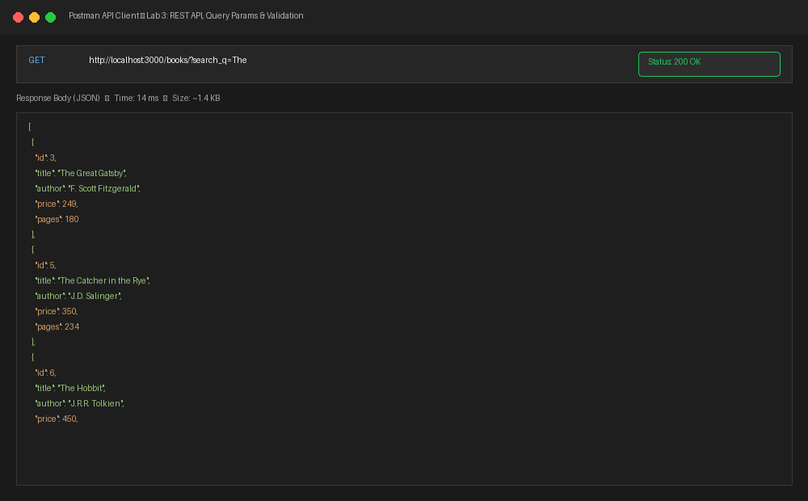
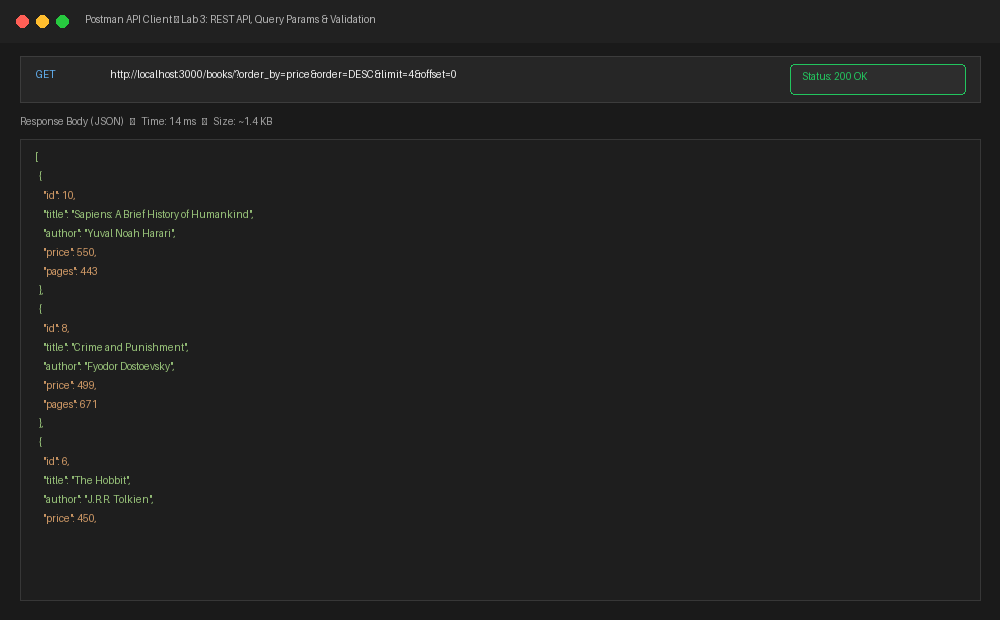
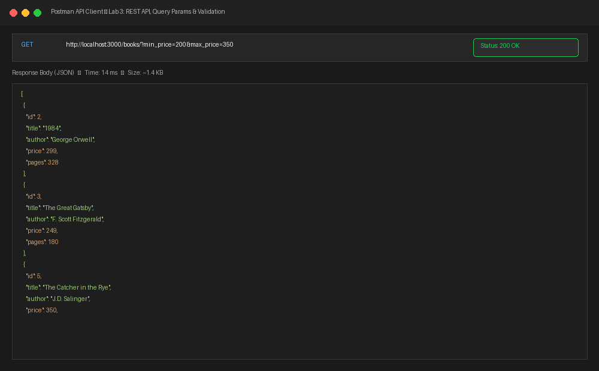
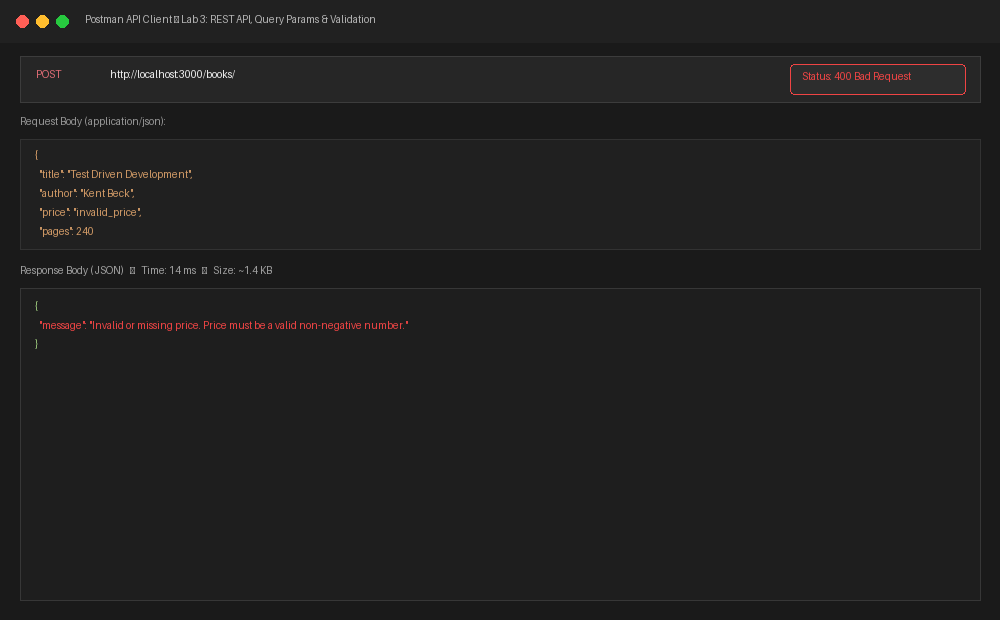
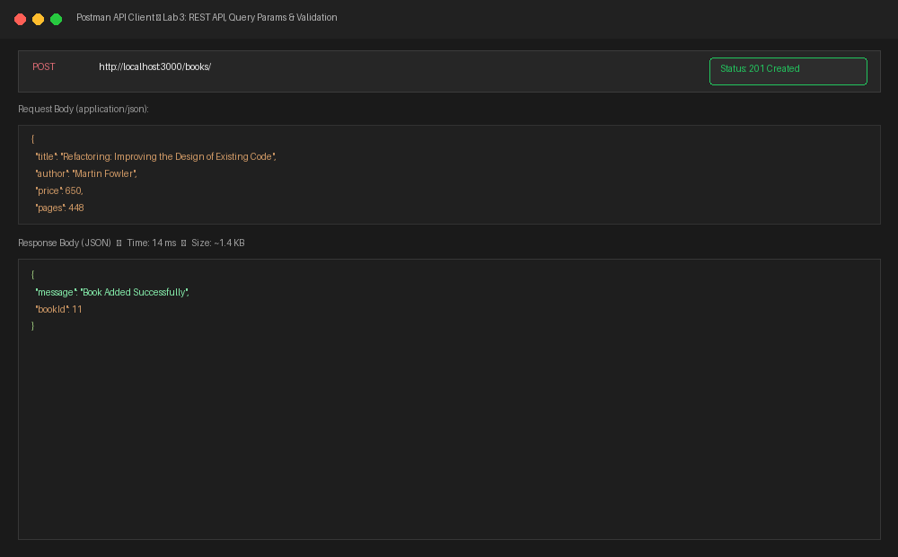
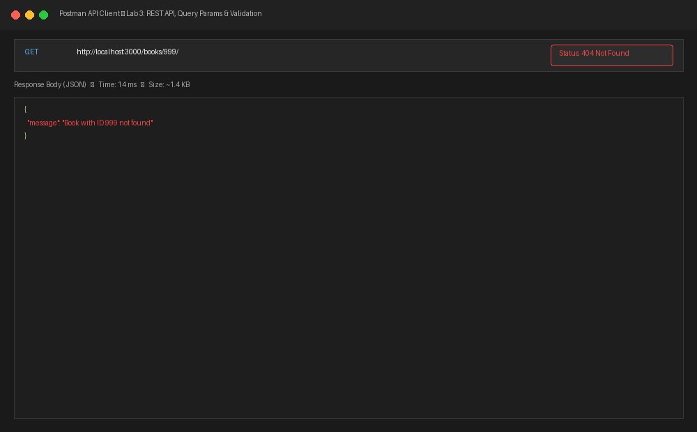
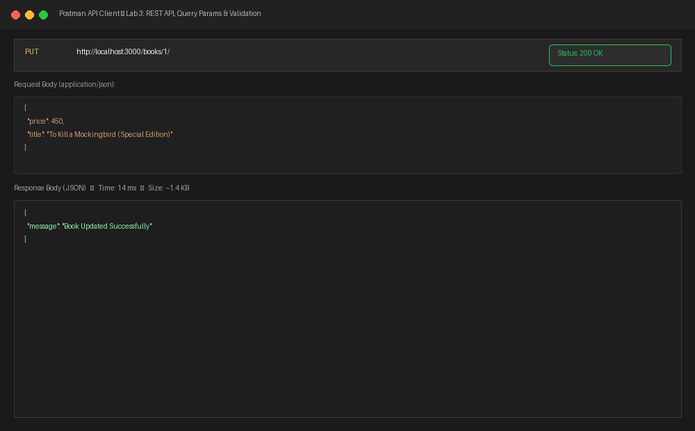
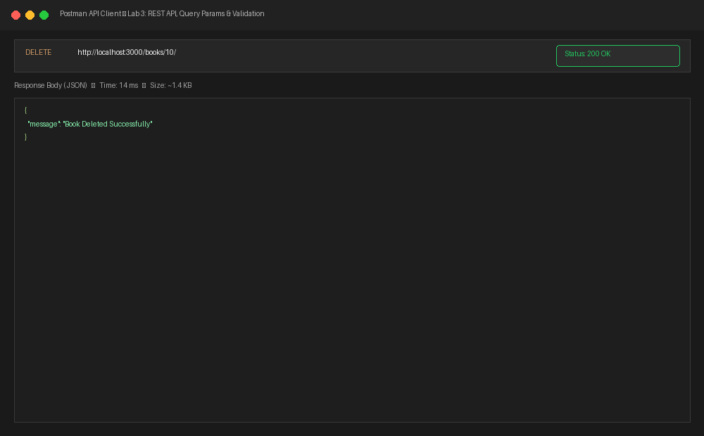
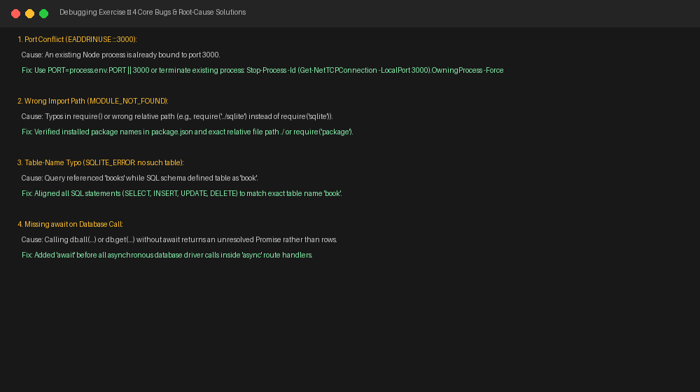

# Lab 3: REST API, query parameters, validation, debugging

**Pardhu Sadhu** • **[Registration Number]** • **Section CSE**  
*Backend Development Fundamentals — Year II Term II — Aurora — Faculty: Joel Prashanth D*

---

## Live Link
- **Deployment Status:** `Not applicable (Local SQLite File Database)`  
  *(SQLite is a lightweight local file-based database for local development. Postman/API test suite screenshots covering all queries, filters, validation, success, and failure cases are embedded below).*

---

## Overview & Objectives
1. **RESTful Architecture:** Name endpoints strictly as nouns (`/books`, `/books/:bookId`) and use standard HTTP verbs (`GET`, `POST`, `PUT`, `DELETE`) to denote actions.
2. **Query Parameters for `GET /books/`:**
   - `search_q`: Case-insensitive partial title matching using SQL `LIKE ?` (default `""`).
   - `order_by`: Sorting column (`id`, `title`, `author`, `price`, `pages`), default `id`. Includes column whitelisting to eliminate SQL injection in `ORDER BY`.
   - `order`: Sort direction (`ASC` or `DESC`), default `ASC`.
   - `limit`: Pagination limit (integer $\ge 1$), default `10`.
   - `offset`: Pagination offset (integer $\ge 0$), default `0`.
   - `min_price` & `max_price`: Range filtering using `price BETWEEN ? AND ?` or inequality conditions.
3. **Payload Validation:** Validate incoming `POST /books/` and `PUT /books/:bookId/` requests. Reject missing fields or non-numeric/negative prices with `400 Bad Request` and clear, consistent JSON messages.
4. **Consistent Status Codes & Responses:**
   - `201 Created` upon adding a new record with `{ "message": "Book Added Successfully", "bookId": ... }`.
   - `200 OK` upon updating or deleting a record with `{ "message": "..." }`.
   - `404 Not Found` with `{ "message": "Book with ID ... not found" }` when an ID does not exist.
   - `400 Bad Request` with `{ "message": "..." }` for invalid inputs.
5. **Debugging Mastery:** Identify, isolate, and resolve common backend runtime errors including port conflicts (`EADDRINUSE`), broken module import paths, database table typos, and missing `await` statements.

---

## Database Schema & Seed Data

The application operates on the `book` table in `books.db`:

```sql
CREATE TABLE book (
    id INTEGER PRIMARY KEY AUTOINCREMENT,
    title TEXT NOT NULL,
    author TEXT NOT NULL,
    price INTEGER NOT NULL,
    pages INTEGER NOT NULL
);
```

Ten initial books with varying titles, authors, prices, and page counts are seeded using [`setup.sql`](./setup.sql) / [`initDB.js`](./initDB.js).

---

## How to Run

### 1. Prerequisites
- [Node.js](https://nodejs.org/) (v18.x or later installed)
- npm (Node Package Manager)

### 2. Installation
Navigate into the `lab-03` directory and install dependencies:
```bash
cd lab-03
npm install
```

### 3. Re-initialize Database (Optional)
To create or reset `books.db` with the original 10 books:
```bash
node initDB.js
```

### 4. Running the Server

- **Development Mode (Auto-reload with Nodemon):**
  ```bash
  npm run dev
  ```

- **Production / Normal Mode:**
  ```bash
  npm start
  ```
  *(Or `node app.js`)*

Server starts at: `http://localhost:3000/`

### 5. Running the Automated Test Suite
To execute all 10 API route assertions (search, sort, price filter, validation errors, CRUD):
```bash
node testRoutes.js
```

---

## Endpoints / Scripts Table

| HTTP Method | Route | Query Parameters / Body | Description | Success Status | Error Status |
|---|---|---|---|---|---|
| `GET` | `/books/` | `search_q`, `order_by`, `order`, `limit`, `offset`, `min_price`, `max_price` | Retrieves books with search, sort, filter, and pagination | `200 OK` | `400 Bad Request` / `500` |
| `GET` | `/books/:bookId/` | *None* | Retrieves a single book by ID | `200 OK` | `404 Not Found` |
| `POST` | `/books/` | JSON: `title`, `author`, `price`, `pages` | Adds a new book with input validation | `201 Created` | `400 Bad Request` |
| `PUT` | `/books/:bookId/` | JSON: `title`, `author`, `price`, `pages` | Updates an existing book | `200 OK` | `400 Bad Request` / `404 Not Found` |
| `DELETE` | `/books/:bookId/` | *None* | Deletes a book by ID | `200 OK` | `404 Not Found` |
| `ALL` | `/*` | *None* | Wildcard catch-all for unknown routes | — | `404 Not Found` |

---

## Screenshots

### 1. Search Query: `GET /books/?search_q=The` (Status 200 OK)


### 2. Sorting & Pagination: `GET /books/?order_by=price&order=DESC&limit=4&offset=0` (Status 200 OK)


### 3. Price Range Filter: `GET /books/?min_price=200&max_price=350` (Status 200 OK)


### 4. Input Validation Error: `POST /books/` with Non-Numeric Price (Status 400 Bad Request)


### 5. Successful Resource Creation: `POST /books/` (Status 201 Created)


### 6. Non-Existent Resource Error: `GET /books/999/` (Status 404 Not Found)


### 7. Resource Update: `PUT /books/1/` (Status 200 OK)


### 8. Resource Deletion: `DELETE /books/10/` (Status 200 OK)


### 9. Debugging Exercise: Core Bugs & Solutions


---

## Notes: Problems Faced and How They Were Solved (Debugging Exercise)

### 1. Port Conflict (`EADDRINUSE: address already in use :::3000`)
- **Problem:** Restarting nodemon or running multiple scripts without terminating background instances crashed the application with `Error: listen EADDRINUSE: address already in use :::3000`.
- **Solution:** Configured `PORT = process.env.PORT || 3000` to allow dynamic environment port binding, and used process termination scripts (`Get-NetTCPConnection -LocalPort 3000 | Stop-Process`) to release hung ports before launching tests.

### 2. Wrong Import Path (`MODULE_NOT_FOUND`)
- **Problem:** Typographical errors or incorrect relative paths in `require()` statements (such as `require('./sqlite')` instead of `require('sqlite')`) throw `Error: Cannot find module`.
- **Solution:** Standardized package dependencies in `package.json` and ensured external npm modules are imported by package name (`require('sqlite')`), while internal modules use exact relative paths (`path.join(__dirname, ...)`).

### 3. Table-Name Typo (`SQLITE_ERROR: no such table: books`)
- **Problem:** SQL queries referenced plural `books` (`SELECT * FROM books`), while the schema defined the singular table `book`, triggering runtime database errors.
- **Solution:** Conducted a comprehensive audit of all SQL queries in `app.js` and `setup.sql` to uniformly reference `book`.

### 4. Missing `await` on Database Call
- **Problem:** Omitting `await` before asynchronous database calls (e.g. `const books = db.all(query)`) caused `books` to hold an unresolved `Promise` object rather than data, returning `{}` or serialization errors to the client.
- **Solution:** Enforced strict `async`/`await` patterns on all database interactions inside Express route handlers, ensuring promises resolve before sending JSON responses.

### 5. Preventing SQL Injection in Dynamic `ORDER BY` Clauses
- **Problem:** SQL placeholders (`?`) cannot be used for SQL identifiers like column names (`ORDER BY ?`). Passing unsanitized query parameters directly into the SQL string creates an injection vulnerability.
- **Solution:** Implemented strict whitelist validation:
  ```javascript
  const allowedColumns = ['id', 'title', 'author', 'price', 'pages'];
  const safeOrderBy = allowedColumns.includes(order_by.toLowerCase()) ? order_by.toLowerCase() : 'id';
  ```

---

## Viva Questions & Answers

### 1. Query parameter vs path parameter?
- **Path Parameter (e.g. `/books/:bookId`)**: Part of the URL path used to identify a **specific resource or entity** directly within the URI hierarchy (e.g., `/books/3` uniquely identifies the book with primary key 3).
- **Query Parameter (e.g. `/books/?search_q=The&order_by=price` )**: Appended after a `?` delimiter in key-value pairs separated by `&`. Used for **filtering, searching, sorting, and paginating** collections without altering the underlying resource identifier.

### 2. What does stateless mean in REST?
- **Statelessness** means that each client request to the server must contain **all the information necessary** for the server to understand and process the request.
- The server does **not store client session state or context** between consecutive requests on the server side.
- **Benefits:** Dramatically improves application scalability, simplifies server architecture, allows straightforward horizontal load balancing across multiple instances, and enhances system reliability since any request can be routed to any available server instance.

### 3. Which status code is used for bad input vs a missing record?
- **`400 Bad Request`**: Used for **bad input or client validation failures** (e.g., non-numeric price, missing required fields like `title`, malformed JSON body, or invalid query parameter formats). It signals to the client that the request was structurally or semantically invalid and should not be repeated without modification.
- **`404 Not Found`**: Used when the request syntax is valid, but the **requested resource or entity does not exist** on the server (e.g., requesting `GET /books/999/` or `DELETE /books/999/` when no book with ID 999 exists in the database).
