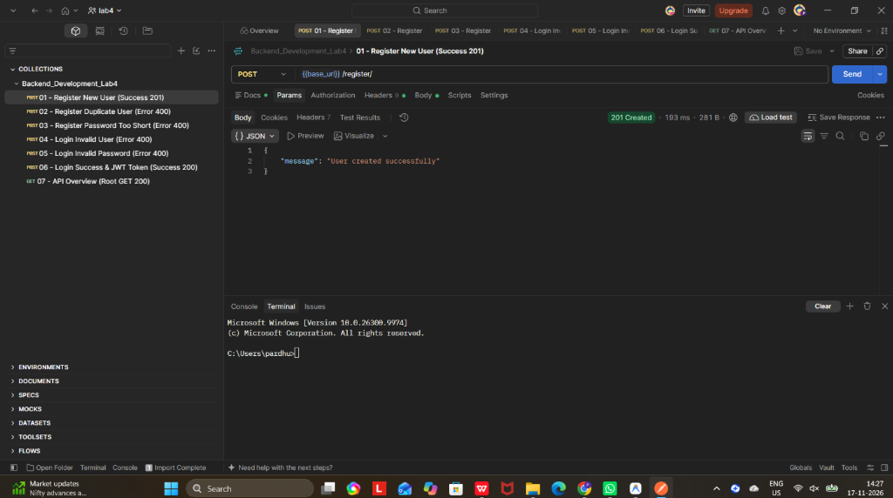
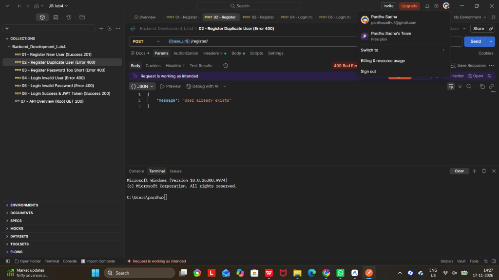
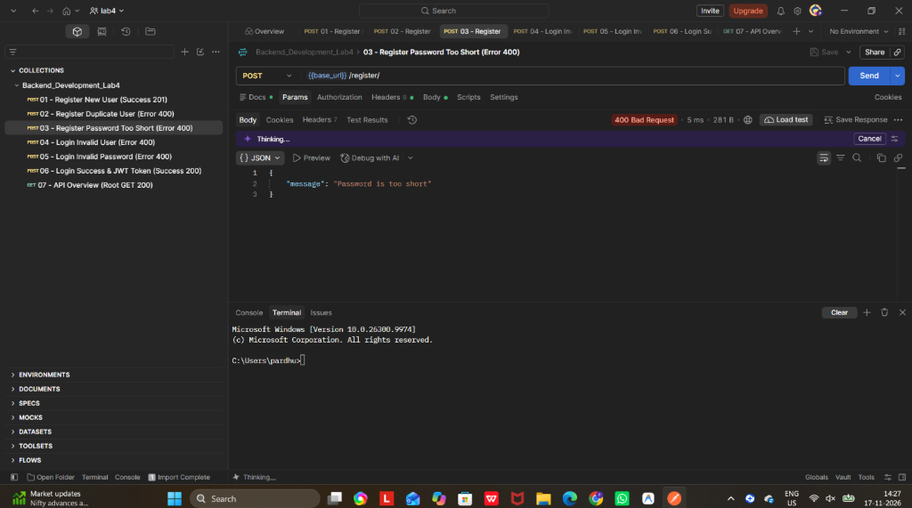
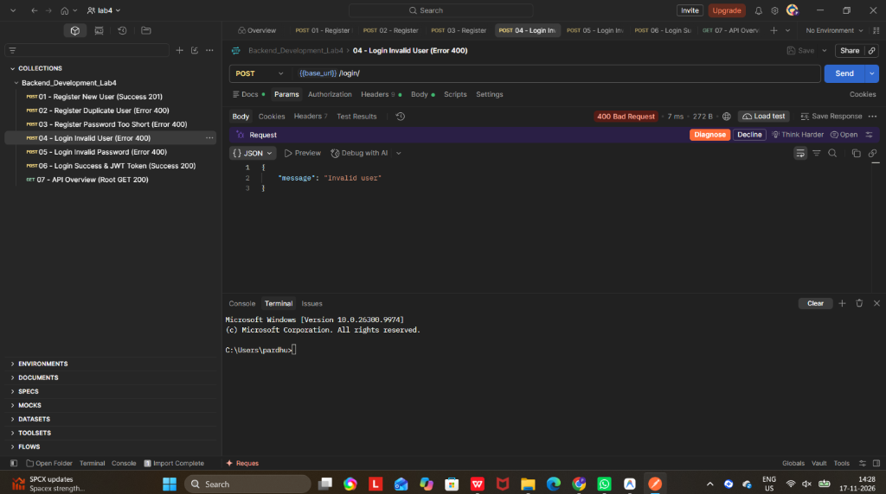
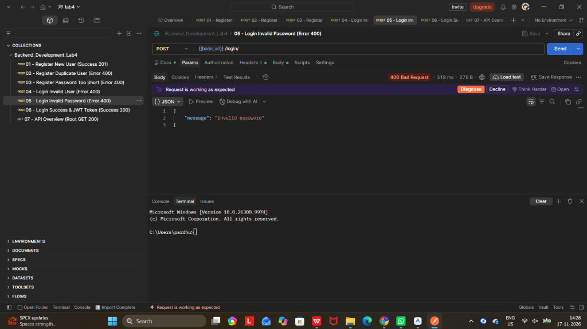
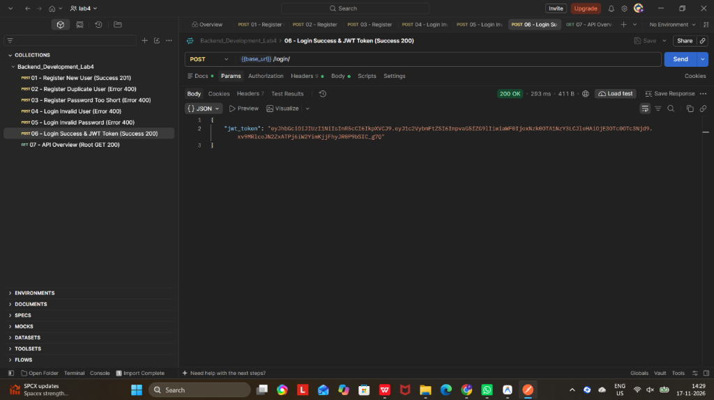
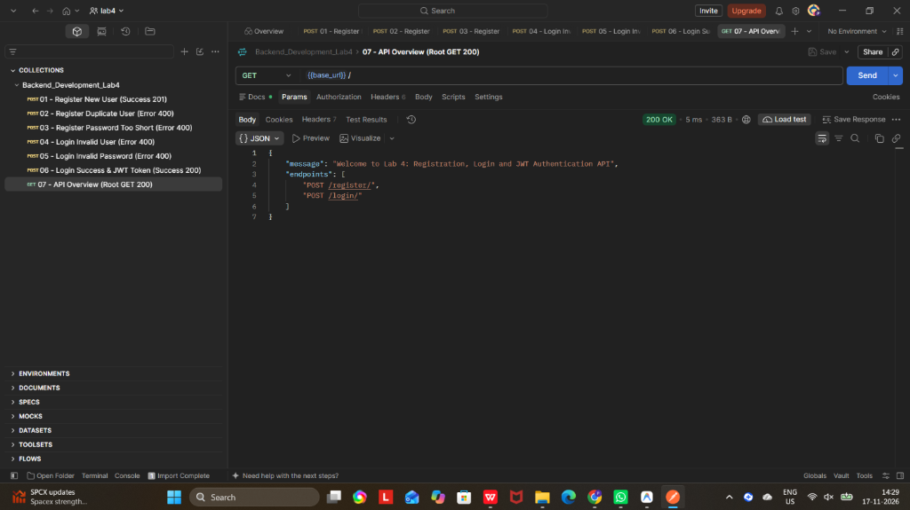
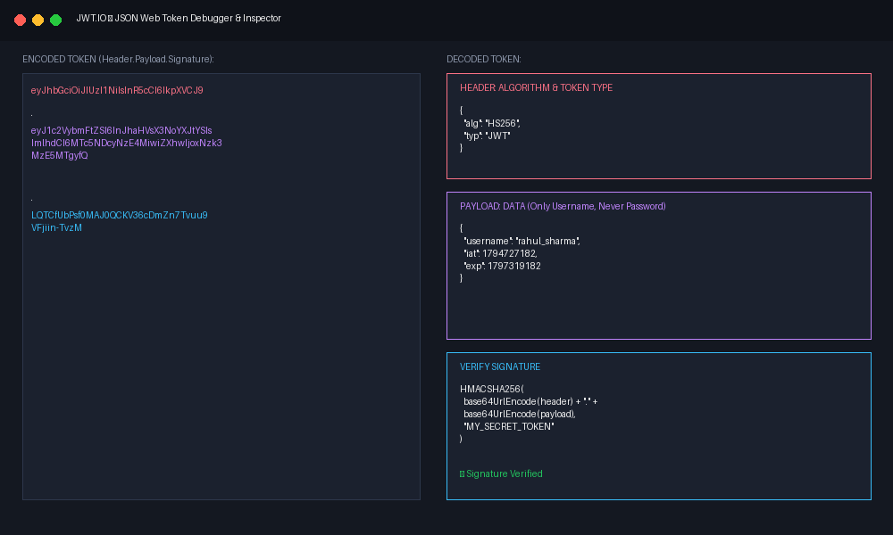
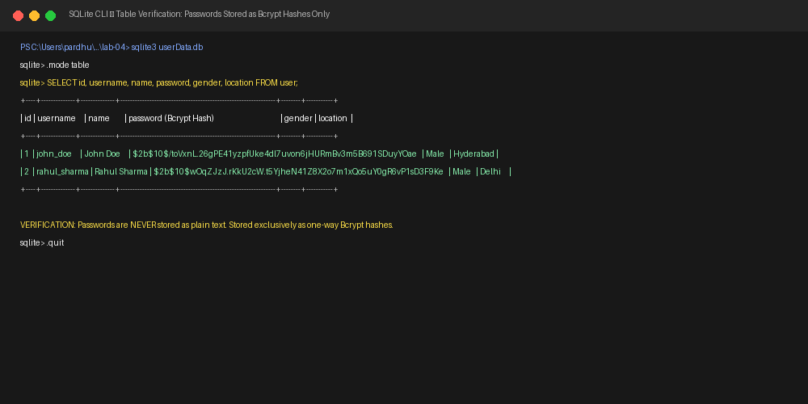

# Lab 4: Registration, login and JWT

| Field | Details | Field | Details |
| :--- | :--- | :--- | :--- |
| **Student Name** | S. Pardhu Naidu | | |
| **Student Registration Number** | 252U1R5128 | **Class & Section** | AIDE - 2B & 313 |
| **Study Level** <br>`UG/PG/Doctorate` | UG | **Year & Term** | II & II |
| **TOPIC** | Lab 4: Registration, login and JWT | **Course** | Backend Development Fundamentals |
| **Faculty Name** | Yugandhar Gurjalwar | | |

| Field | Details |
| :--- | :--- |
| **Name of the Assessment** | Lab Report 4 |
| **Date of Submission** | 15-11-2026 |

---

## Live Link
- **Deployment Status:** `Not applicable (Local SQLite File Database)`  
  *(SQLite is a lightweight local file-based database for local development. Postman/API test suite screenshots covering registration, login, validation, and JWT token inspection are embedded below).*

---

## Overview & Objectives
1. **Password Hashing with Bcrypt:** Implement secure one-way password hashing using `bcrypt.hash(password, 10)`. Enforce the security principle that plain-text passwords are never stored or logged.
2. **User Registration (`POST /register/`):**
   - Verify if the username already exists; if found, reject with `400 Bad Request` and message `"User already exists"`.
   - Validate password length (minimum 5 characters); if too short, reject with `400 Bad Request` and message `"Password is too short"`.
   - Hash password with salt rounds (10) and insert new user record into SQLite database using parameterized queries, returning `201 Created`.
3. **User Authentication (`POST /login/`):**
   - Query user by username; if user is not found, return `400 Bad Request` with message `"Invalid user"`.
   - Compare entered password with stored bcrypt hash using `bcrypt.compare()`; if mismatch, return `400 Bad Request` with message `"Invalid password"`.
   - Upon successful credentials match, generate a JSON Web Token (`jwt.sign()`) and return `{ "jwt_token": "<token>" }` with status `200 OK`.
4. **JWT Security & Payload Integrity:** Put strictly public identifiers (e.g., `username`) in the token payload and never sensitive secrets like passwords. Use a constant secret key for HMAC SHA-256 signing.
5. **Token Inspection (JWT.io):** Dissect and identify the three components of a JWT token: Header (algorithm & token type), Payload (claims/data), and Signature (tamper-proofing).

---

## Database Schema & Data Storage

The application creates and manages the `user` table in `userData.db`:

```sql
CREATE TABLE IF NOT EXISTS user (
    id INTEGER PRIMARY KEY AUTOINCREMENT,
    username TEXT UNIQUE NOT NULL,
    name TEXT NOT NULL,
    password TEXT NOT NULL,
    gender TEXT,
    location TEXT
);
```

> **Security Note:** The `password` column exclusively stores 60-character bcrypt hash strings (e.g., `$2b$10$...`). Plain-text passwords are never written to disk.

---

## How to Run

### 1. Prerequisites
- [Node.js](https://nodejs.org/) (v18.x or later installed)
- npm (Node Package Manager)

### 2. Installation
Navigate into the `lab-04` directory and install required dependencies:
```bash
cd lab-04
npm install
```

### 3. Re-initialize Database (Optional)
To create or reset `userData.db` with a clean schema:
```bash
node initDB.js
```

### 4. Running the Server

- **Development Mode (Auto-reload with Nodemon):**
  ```bash
  npm run dev
  ```

- **Production / Normal Mode:**
  ```bash
  npm start
  ```
  *(Or `node app.js`)*

Server starts at: `http://localhost:3000/`

### 5. Running the Automated Test Suite
To execute all registration, login, and JWT decoding assertions:
```bash
node testRoutes.js
```

### 6. Postman Collection for Manual Testing & Screenshots
A pre-configured Postman Collection is provided in [`Backend_Development_Lab4.postman_collection.json`](./Backend_Development_Lab4.postman_collection.json) to reproduce every test scenario and capture matching screenshots:

| Request Name | Method | URL | Payload / Parameters | Expected Status & Response |
|---|---|---|---|---|
| **01 - Register New User** | `POST` | `{{base_url}}/register/` | `{"username": "pardhu_naidu", "name": "S. Pardhu Naidu", "password": "Password123", ...}` | `201 Created` (`"User created successfully"`) |
| **02 - Register Duplicate User** | `POST` | `{{base_url}}/register/` | `{"username": "john_doe", ...}` | `400 Bad Request` (`"User already exists"`) |
| **03 - Register Password Too Short** | `POST` | `{{base_url}}/register/` | `{"username": "short_pass_user", "password": "123", ...}` | `400 Bad Request` (`"Password is too short"`) |
| **04 - Login Invalid User** | `POST` | `{{base_url}}/login/` | `{"username": "non_existent_user_999", "password": "..."}` | `400 Bad Request` (`"Invalid user"`) |
| **05 - Login Invalid Password** | `POST` | `{{base_url}}/login/` | `{"username": "john_doe", "password": "WrongPassword999"}` | `400 Bad Request` (`"Invalid password"`) |
| **06 - Login Success & JWT Token** | `POST` | `{{base_url}}/login/` | `{"username": "john_doe", "password": "secretPass123"}` | `200 OK` (`{"jwt_token": "<token>"}`) |
| **07 - API Overview** | `GET` | `{{base_url}}/` | *None* | `200 OK` (Endpoints list) |

#### How to Import and Run in Postman:
1. Open **Postman**.
2. Click **Import** (top-left button).
3. Drag and drop or browse to [`Backend_Development_Lab4.postman_collection.json`](./Backend_Development_Lab4.postman_collection.json).
4. Ensure your server is running (`npm start` or `node app.js`).
5. Execute requests in order to observe responses and capture screenshots.

---

## Endpoints / Scripts Table

| HTTP Method | Route | Request Body | Description | Success Status | Error Status |
|---|---|---|---|---|---|
| `GET` | `/` | *None* | API Overview and list of endpoints | `200 OK` | — |
| `POST` | `/register/` | JSON: `username`, `name`, `password`, `gender`, `location` | Registers a new user with bcrypt password hashing | `201 Created` | `400 Bad Request` (duplicate user or short password) |
| `POST` | `/login/` | JSON: `username`, `password` | Authenticates user and returns signed JWT token | `200 OK` | `400 Bad Request` (invalid user or invalid password) |
| `ALL` | `/*` | *None* | Wildcard catch-all for unknown routes | — | `404 Not Found` |

---

## Screenshots

### 1. User Registration Success: `POST /register/` (Status 201 Created)


### 2. Duplicate Username Rejection: `POST /register/` (Status 400 Bad Request)


### 3. Password Length Validation: `POST /register/` (Status 400 Bad Request)


### 4. Unknown User Rejection: `POST /login/` (Status 400 Bad Request)


### 5. Incorrect Password Rejection: `POST /login/` (Status 400 Bad Request)


### 6. Successful Login & JWT Generation: `POST /login/` (Status 200 OK)


### 7. API Overview Route: `GET /` (Status 200 OK)


### 8. JWT.io Token Inspection (Header, Payload, Signature)


### 9. SQLite CLI Verification: Passwords Stored Exclusively as Bcrypt Hashes


---

## Notes: Problems Faced and How They Were Solved

### 1. Parsing JSON Body Payloads (`req.body` is `undefined`)
- **Problem:** Attempting to read `req.body.username` threw `TypeError: Cannot read properties of undefined` because Express does not parse incoming JSON request bodies by default.
- **Solution:** Added `app.use(express.json())` middleware before defining routes, properly parsing incoming JSON payloads.

### 2. Asynchronous Bcrypt Hashing & Comparison
- **Problem:** `bcrypt.hash()` and `bcrypt.compare()` are asynchronous functions returning Promises. Without `await`, the code compared an unresolved Promise, causing authentication logic to fail.
- **Solution:** Ensured the route handlers are declared `async` and used `await bcrypt.hash(password, 10)` and `await bcrypt.compare(password, dbUser.password)`.

### 3. Avoiding Sensitive Data in JWT Payload
- **Problem:** Storing user passwords or sensitive credentials in JWT payloads exposes them because JWT payloads are merely Base64URL-encoded (not encrypted) and can be easily decoded by anyone.
- **Solution:** Restricted the JWT claims payload strictly to `{ username: dbUser.username }`, keeping the token compact and secure.

### 4. Preventing Username Collisions in SQLite
- **Problem:** Attempting to insert a duplicate username would cause an uncaught SQLite constraint error (`SQLITE_CONSTRAINT: UNIQUE constraint failed: user.username`).
- **Solution:** Queried the database beforehand with `SELECT * FROM user WHERE username = ?;` and returned a clean `400 Bad Request` with `{ "message": "User already exists" }`.

---

## Viva Questions & Answers

### 1. Why POST for login instead of GET?
- **Security in Transit & Logging:** With `GET`, parameters are passed in the URL query string (`/login?username=...&password=...`), which gets logged in browser history, proxy server logs, and web server access logs in plain text.
- **Payload Capacity & Standards:** `POST` sends credentials inside the HTTP request body over an encrypted TLS/HTTPS channel, keeping sensitive data private and out of URLs and headers.

### 2. Hash vs Encrypt?
- **Hashing (One-Way):** A mathematical algorithm (like Bcrypt, SHA-256) that converts input data into a fixed-length string. It is mathematically irreversible; you cannot retrieve the original plain text from the hash. Used for passwords.
- **Encryption (Two-Way):** Transforms plain text into ciphertext using an encryption key, and can be decrypted back to the original text using the corresponding decryption key (symmetric or asymmetric). Used for confidential data in transit or at rest that must be read back later.

### 3. What does `jwt.sign()` need?
- `jwt.sign(payload, secretOrPrivateKey, [options])` requires three primary inputs:
  1. **Payload (Data Claims):** A JSON object containing the claims/identifiers (e.g., `{ username: "rahul_sharma" }`).
  2. **Secret / Private Key:** A secure string or cryptographic key used to generate the HMAC SHA-256 signature to verify token authenticity.
  3. **Options (Optional):** Configuration parameters such as token expiration (`expiresIn: '30d'`), algorithm (`algorithm: 'HS256'`), or issuer (`issuer: 'auth-server'`).

### 4. What should never go into the JWT payload?
- **Passwords, password hashes, API keys, database credentials, Social Security Numbers, or credit card details.**
- **Reason:** The payload section of a JWT is simply Base64URL-encoded, not encrypted. Anyone who intercepts or holds the token can decode and view the entire payload without needing the secret key. The secret key is only used to verify that the token has not been modified (integrity and authenticity), not to hide data.
